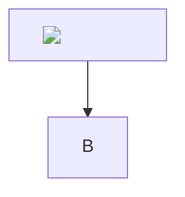

# XSS Test Vectors

## Mermaid XSS 1

## Math XSS
$\text{}$

## HTML details

Click me

## SVG
<svg onload="alert(1)">

## Link javascript
[test](javascript:alert(1))

## Anchor href
<a href="javascript:alert(1)">click</a>

## Form action
<form action="javascript:alert(1)"><input type=submit></form>
